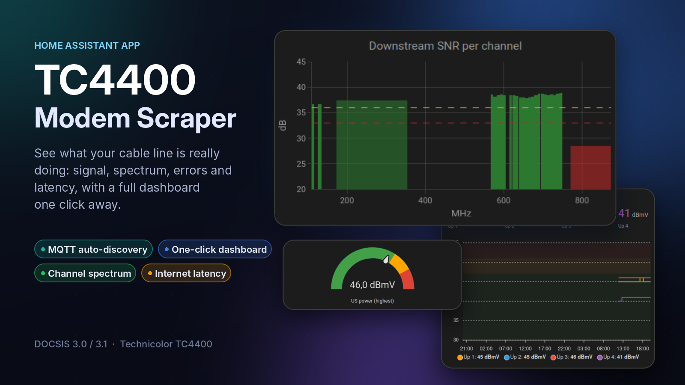
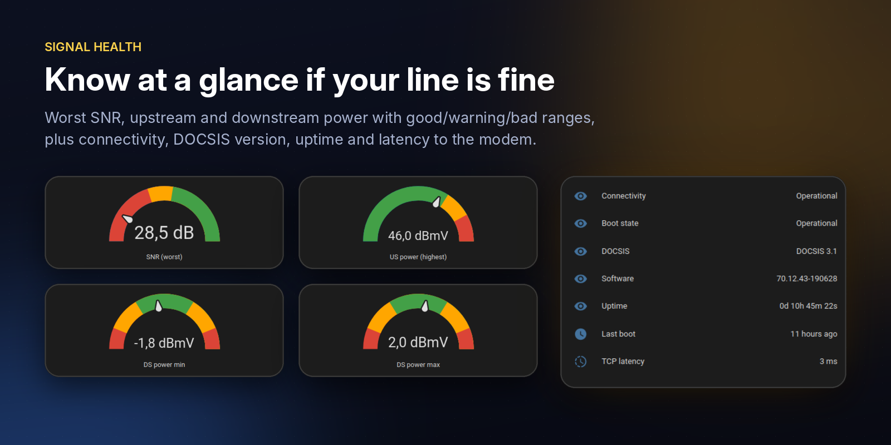
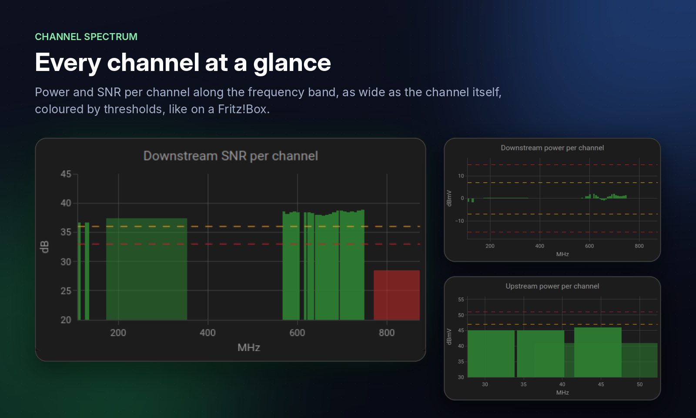
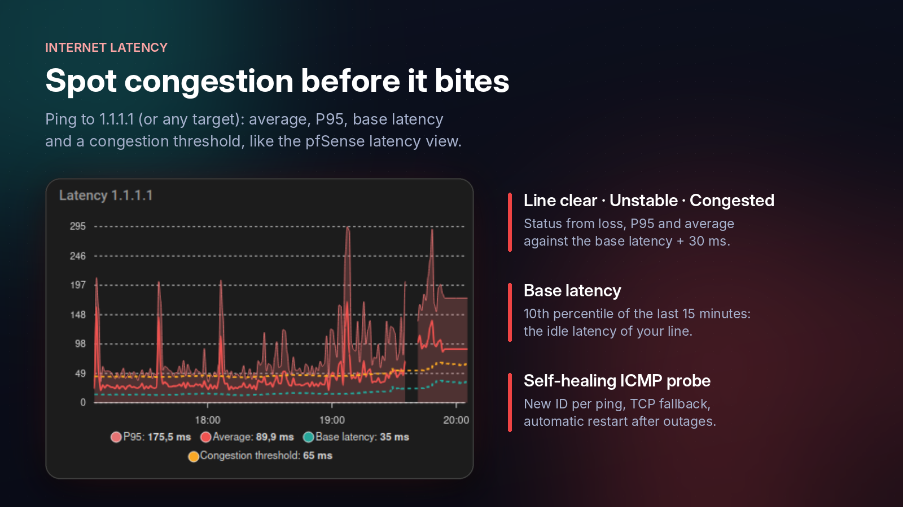
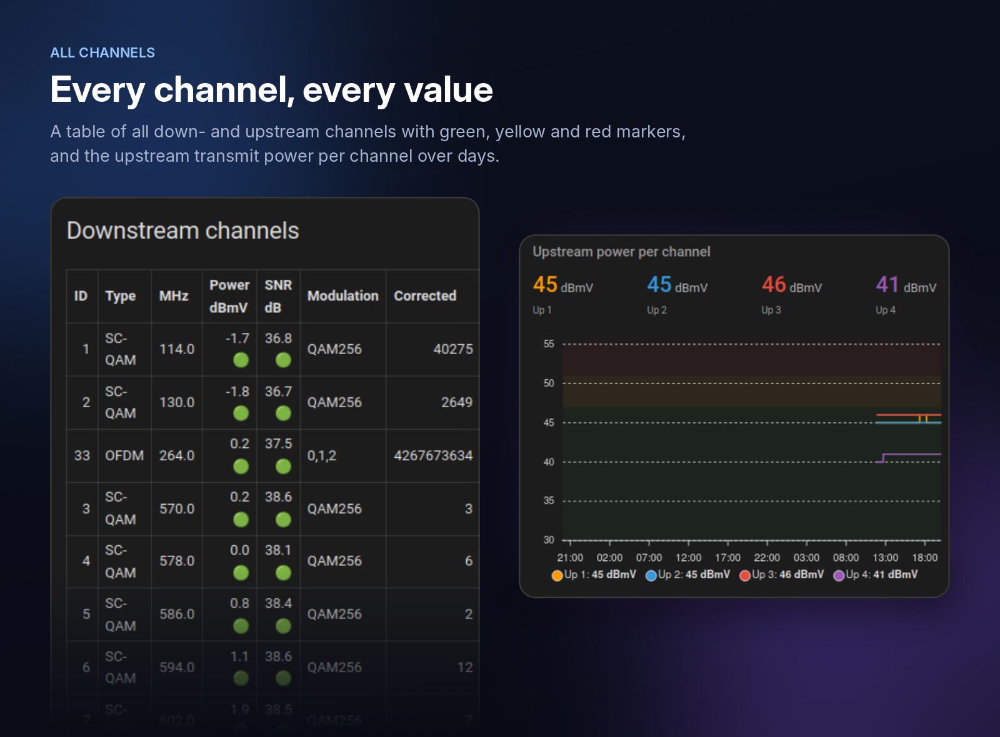
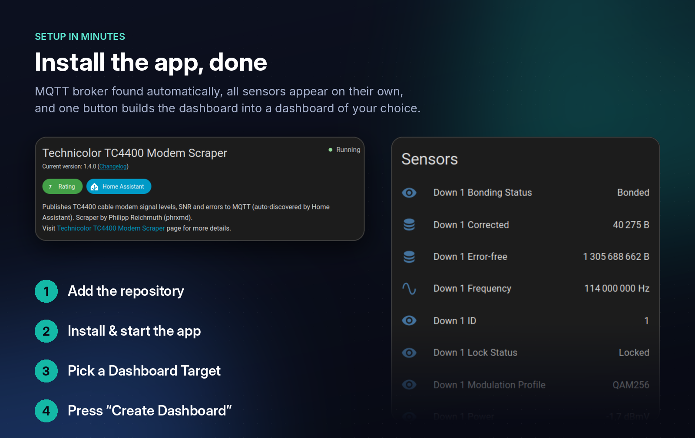

# Technicolor TC4400 Modem Scraper



Publishes the signal status of a Technicolor TC4400 cable modem (downstream/upstream
channels, power, SNR, corrected/uncorrectable errors, uptime, IPs) to MQTT with
Home Assistant auto-discovery. A **TC4400** device with all sensors appears
automatically under the MQTT integration — no YAML needed.

## Credits

This scraper was written by **[Philipp Reichmuth (phrxmd)](https://github.com/phrxmd)** —
original repository: [phrxmd/Technicolor_modem_scrape](https://github.com/phrxmd/Technicolor_modem_scrape).
It is in turn based on the Arris and Netgear modem scrapers by
**[mmiller7](https://github.com/mmiller7)** ([Arris_modem_scrape](https://github.com/mmiller7/Arris_modem_scrape),
[Netgear_modem_scrape](https://github.com/mmiller7/Netgear_modem_scrape)).
The Home Assistant add-on packaging, installer and refactoring in this repository
were added by [coaxx77](https://github.com/coaxx77).

Licensed under [CC BY-NC-SA 4.0](https://creativecommons.org/licenses/by-nc-sa/4.0/), like the original.

## What you get











<sub>Screenshots from a real TC4400 on a Vodafone cable line.</sub>

Two install methods, pick one.

---

## Option A — Home Assistant add-on (HA OS / Supervised) — recommended

Requirements:

- the **Mosquitto broker** add-on (or any MQTT broker) and the MQTT integration
- **Home Assistant must be able to open the modem's web interface**
  (`http://192.168.100.1`). Check it first: open that address in a browser on a PC in
  the same network — the TC4400 login prompt must appear. Behind pfSense, OPNsense or
  OpenWrt this usually needs a virtual IP, an outbound NAT rule and possibly a static
  ARP entry on the router: **[Reaching the modem's web interface](MODEM_ACCESS.md)**

1. **Settings → Apps → app store → ⋮ → Repositories** (before Home Assistant 2026.11:
   *Settings → Add-ons → Add-on Store*), add `https://github.com/coaxx77/tc4400-ha-addon`
   — or open [this link](https://my.home-assistant.io/redirect/supervisor_add_addon_repository/?repository_url=https%3A%2F%2Fgithub.com%2Fcoaxx77%2Ftc4400-ha-addon)
2. Install **Technicolor TC4400 Modem Scraper**.
3. On the **Configuration** tab, enter your modem password if you changed it
   from the default `bEn2o#US9s`.
4. **Start** the add-on (and enable *Start on boot*).

That's it. The MQTT broker and its credentials are detected automatically from the
Mosquitto add-on. To use a different broker, fill in `mqtt_host` (and port/user/password).

| Option | Default | Notes |
|---|---|---|
| `modem_url` | `http://192.168.100.1` | TC4400 only speaks plain HTTP |
| `modem_username` / `modem_password` | `admin` / `bEn2o#US9s` | |
| `scan_interval` | `300` | seconds (30–86400) |
| `mqtt_host`, `mqtt_port`, `mqtt_username`, `mqtt_password` | *(empty)* | leave empty to auto-use Mosquitto add-on |
| `mqtt_topic_prefix` | `homeassistant/sensor` | discovery prefix |
| `mqtt_uid_prefix` | `cablemodem` | |
| `verbose` | `false` | log full scraper output each run |

> Release notes: [CHANGELOG](technicolor_modem_scrape/CHANGELOG.md)

---

## Option B — any Linux host (systemd)

Runs on any Debian/Ubuntu/Fedora machine, Proxmox LXC, Raspberry Pi, etc. that can
reach both the modem and the MQTT broker:

```bash
curl -fsSL https://raw.githubusercontent.com/coaxx77/tc4400-ha-addon/main/install.sh | sudo bash
```

The installer installs `curl` + `mosquitto-clients`, asks for modem and MQTT
settings (stored in `/etc/technicolor-modem-scrape.conf`, mode 600), and sets up a
systemd timer (default every 5 minutes). Re-run it to change settings.

```bash
journalctl -u technicolor-modem-scrape.service -n 50   # logs
sudo bash install.sh --uninstall                      # remove
```

---

## Manual / advanced use

The script takes all settings from environment variables or from a config file
given as the first argument — no editing required:

```bash
MODEM_PASSWORD='secret' MQTT_HOST=192.168.1.10 MQTT_USERNAME=mqtt MQTT_PASSWORD=pw \
  ./technicolor_modem_scrape/rootfs/usr/bin/technicolor_signal_dump.sh

DRY_RUN=1 ./technicolor_signal_dump.sh     # print MQTT messages instead of publishing
```

Variables: `MODEM_URL`, `MODEM_USERNAME`, `MODEM_PASSWORD`, `MQTT_HOST`, `MQTT_PORT`,
`MQTT_USERNAME`, `MQTT_PASSWORD`, `MQTT_TOPIC_PREFIX`, `MQTT_UID_PREFIX`,
`MQTT_LOGGING_TOPIC`, `DRY_RUN`.

## Dashboard

The app adds a **Dashboard Target** dropdown (your existing dashboards or a new one)
and a **Create Dashboard** button to the TC4400 device. One press writes a complete
TC4400 view into the chosen dashboard, leaving its other views untouched: status, gauges, internet latency, a Fritz!Box-style channel
spectrum, a channel table, upstream/downstream charts with coloured good/warning/bad ranges, errors and
latency. It uses the optional cards *Plotly Graph Card* and *ApexCharts Card* when
they are installed and falls back to built-in cards otherwise. Details, options and
how to call it as an action: [app documentation](technicolor_modem_scrape/DOCS.md#dashboard).

Besides one sensor set per channel, the scraper publishes **Summary** sensors across
all channels (locked channel counts, worst/average SNR, power ranges, error totals and
errors per minute), TCP latency, last boot time, and the full channel lists as
attributes. An **internet latency probe** (default target `1.1.1.1`) adds average,
P95, min/max, jitter, loss, base latency and a congestion status per target. A static example dashboard with built-in cards only is in
[`examples/dashboard.yaml`](examples/dashboard.yaml).

## MQTT topics

`XXXX` = modem serial number.

- `homeassistant/sensor/technicolor_scraper/login` — `success` / `failed`
- `homeassistant/sensor/cablemodemXXXX/status` — general modem status
- `homeassistant/sensor/cablemodemXXXX/downstreamN` — downstream channel ID `N`
- `homeassistant/sensor/cablemodemXXXX/upstreamN` — upstream channel `N`
- `homeassistant/sensor/cablemodemXXXX/summary` — aggregates across all channels
- `homeassistant/sensor/cablemodemXXXX/channels_down`, `.../channels_up` — channel lists
- `tc4400_scraper/dashboard/create` — command topic of the dashboard generator (app only)

## Exit codes

`10` mosquitto_pub missing · `20` MQTT publish error · `21` modem login/page failed ·
`22` modem unreachable · `23` page could not be parsed

Tested on TC4400 firmware 70.12.43-190628.
